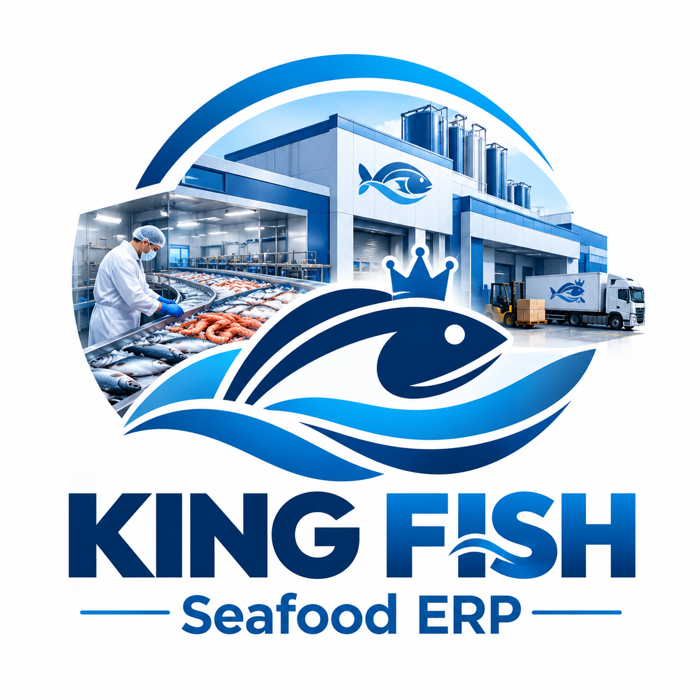

<div align="center">

# 🐟 KING FISH
### SEAFOOD ERP SYSTEM

**🌊 From Catch to Customer — Complete Operational Control**

<p>
  <strong>An Integrated ERP Solution for Seafood Manufacturing, Quality Control, Cold Storage & International Export</strong>
</p>



<br/>

[](https://nextjs.org/)
[](https://react.dev/)
[](https://www.typescriptlang.org/)
[](https://tailwindcss.com/)

[🚀 Features](#-core-modules) •
[🛠️ Installation](#-installation) •
[🏗️ Architecture](#️-project-architecture) •
[🔐 Security](#-security--production-readiness) •
[👨‍💻 Developer](#-developer)

</div>

---

## 🌐 Overview

**KING FISH Seafood ERP** is a specialized enterprise resource planning application designed for seafood processing and export businesses.

The system organizes critical operational workflows in one interface, helping teams manage incoming seafood, manufacturing, warehouse operations, quality inspections, sales, traceability, and international shipments.

The intended workflow covers the seafood supply chain:

`🚢 Reception` → `⚖️ Weighing` → `🏭 Production` → `❄️ Cold Storage` → `🧪 Quality Control` → `📦 Export` → `🌍 Customer`

---

## 📊 System Highlights

<div align="center">

| 🏭 Operational Departments | 🌍 Interface Languages | 🔎 Traceability | 📱 Responsive UI |
|:---:|:---:|:---:|:---:|
| **8 Modules** | **3 Languages** | **Lot Tracking** | **Multi-Device** |

</div>

## 🚀 Core Modules

<table>
<tr>
<td width="50%" valign="top">

### ⚖️ 01. Reception & Weighing

- 🐟 Register incoming seafood
- 🚢 Record suppliers and vessels
- ⚖️ Track received quantities and weights
- 🌡️ Record product temperatures
- ✅ Manage acceptance and rejection

</td>
<td width="50%" valign="top">

### 🏭 02. Production & Manufacturing

- 🔄 Track production batches
- 🧾 Generate lot reference numbers
- 🐠 Link raw materials to finished products
- 📉 Record production waste
- ⚙️ Monitor production lines

</td>
</tr>
<tr>
<td width="50%" valign="top">

### ❄️ 03. Warehouse & Cold Storage

- 📦 Monitor stock quantities
- 🧊 Organize cold rooms and locations
- 🌡️ Track storage temperatures
- 🚨 Identify low-stock conditions
- 🔍 Support inventory monitoring

</td>
<td width="50%" valign="top">

### 🧪 04. Quality Control & Food Safety

- 🔬 Perform quality inspections
- 👁️ Evaluate appearance and color
- 👃 Record smell and texture checks
- 📋 Maintain inspection records
- 🛡️ Manage approval and rejection workflows

</td>
</tr>
<tr>
<td width="50%" valign="top">

### 🚢 05. Export & Shipping

- 📦 Organize export shipments
- 🚛 Track containers and destinations
- 🌍 Manage international deliveries
- 📑 Associate products with shipments
- 📍 Monitor shipment status

</td>
<td width="50%" valign="top">

### 🤝 06. Sales & Customer Management

- 👥 Maintain customer records
- 🛒 Create and manage sales orders
- 💳 Track payment statuses
- 📅 Manage delivery dates
- 🧾 Organize sales information

</td>
</tr>
<tr>
<td width="50%" valign="top">

### 🔎 07. Traceability & Recall

- 🔗 Track production lot numbers
- 🧬 Connect reception and production records
- 📦 Trace products through inventory
- 🚢 Associate lots with export shipments
- ⚠️ Support product recall investigations

</td>
<td width="50%" valign="top">

### 🔐 08. Accounts & Permissions

- 👤 Manage user accounts
- 🛡️ Organize access permissions
- 🔑 Plan role-based access control
- 📋 Support operational accountability
- 🔒 Prepare for secure user management

</td>
</tr>
</table>

---

## 🌍 Multilingual Experience

The interface is designed to support three languages:

<div align="center">

| Language | Support |
|:---|:---|
| 🇪🇬 Arabic | العربية — RTL layout |
| 🇬🇧 English | English interface |
| 🇮🇹 Italian | Interfaccia italiana |

</div>

The multilingual interface helps teams work with a consistent application experience across different languages.

## 🎨 User Experience

- 🌗 Light and dark themes
- 📱 Responsive layouts for desktop, tablet, and mobile
- 🔍 Search and filtering tools
- 🪟 Modal forms for data entry
- 🏷️ Color-coded status badges
- 📊 Dashboard statistics
- 🧾 Automatic reference number generation
- 🗂️ CRUD interfaces for operational records

## 🛠️ Technology Stack

<div align="center">

| Technology | Purpose |
|:---|:---|
| ⚡ Next.js 16 | React application framework |
| ⚛️ React 19 | Component-based user interface |
| 📘 TypeScript | Static typing |
| 🎨 Tailwind CSS 4 | Styling and responsive layouts |
| 🧩 Lucide React | Interface icons |
| 💾 Browser LocalStorage | Demo data persistence |

</div>

## 🏗️ Project Architecture

```text
KING-FISH-Seafood-ERP/
│
├── app/
│   ├── login/
│   │   └── page.tsx
│   ├── page.tsx
│   ├── layout.tsx
│   └── globals.css
│
├── components/
│   └── ui/
│       ├── button.tsx
│       ├── badge.tsx
│       └── modal.tsx
│
├── lib/
│   ├── types.ts
│   ├── translations.ts
│   ├── storage.ts
│   └── utils.ts
│
├── public/
│   └── king-fish-logo.png
│
├── package.json
└── README.md
```

## 💻 Installation

### Prerequisites

- Node.js compatible with the project's Next.js version
- pnpm
- Git

### 1️⃣ Clone the Repository

```bash
git clone https://github.com/omarabdeenaidevelpor-rgb/KING-FISH-Seafood-ERP-.git
```

### 2️⃣ Navigate to the Project

```bash
cd KING-FISH-Seafood-ERP-
```

### 3️⃣ Install Dependencies

```bash
pnpm install
```

### 4️⃣ Start Development

```bash
pnpm dev
```

Open your browser:

```text
http://localhost:3000
```

### 5️⃣ Build for Production

```bash
pnpm build
pnpm start
```

---

## 🔐 Security & Production Readiness

> ⚠️ **Important:** The current project description specifies browser LocalStorage for demo data persistence. This is not sufficient for a multi-user production ERP system.

Before using the application for real factory operations, implement and test:

- 🔒 Secure server-side authentication
- 🗄️ A persistent database and backend API
- 👥 Server-enforced role-based authorization
- 🧾 Audit logs for critical operations
- 💾 Automated backups and recovery procedures
- 🔑 Secure secret and environment variable management
- 🌡️ Reliable temperature monitoring and alert handling
- 🛡️ Appropriate data protection and security controls

**Production readiness must be verified against the actual implementation and deployment environment.**

## 🚀 Deployment

The application can be prepared for hosting on a compatible Next.js platform, such as:

- ▲ Vercel
- 🚂 Railway
- ☁️ Other Node.js-compatible hosting platforms

Database provisioning, environment configuration, authentication, and production security must be completed as applicable before live use.

---

## 👨‍💻 Developer

<div align="center">

### **AI Developer Omar Abdeen**

💻 Full Stack Developer  
⚡ Web Development • AI Solutions • Business Systems

<a href="https://github.com/omarabdeenaidevelpor-rgb">
  
</a>

<a href="https://github.com/omarabdeenaidevelpor-rgb/KING-FISH-Seafood-ERP-">
  
</a>

</div>

---

## 📄 License

**Proprietary — KING FISH Seafood Company**

All rights reserved unless otherwise authorized by the project owner.

---

<div align="center">

### 🐟 KING FISH Seafood ERP

**Smart Operations. Reliable Traceability. Connected Seafood Exports.**

<sub>Developed by AI Developer Omar Abdeen • Version 1.0.0</sub>

</div>
